# Screens

What each screen shows, what it does, and what it says. The screenshots are
from BenchBook for Mac. They show the layout and content, not the look: the
Windows app uses Windows controls (see
[windows-app.md](windows-app.md#screens)).

Each section names the Swift file that builds the screen. When this page
doesn't answer a question, such as the exact wording of a rare error, that
file is the reference. The repo is public.

Wording: keep the meaning and tone of every message. Change it only where
Windows has its own words, such as Explorer for Finder, Recycle Bin for Trash,
and Ctrl for ⌘. The Mac uses British English ("colour"), and so does Windows.

Counts: use the singular for one ("1 reference", "1 note", "1 part").

## Main window

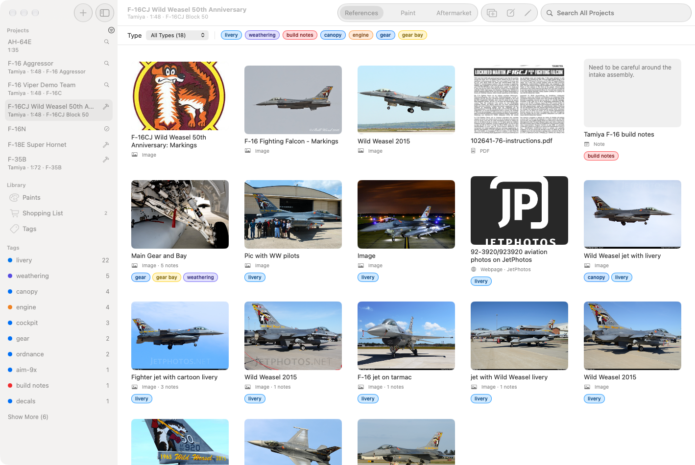

`Views/ContentView.swift`, `Views/ProjectSidebar.swift`, `Views/ProjectWorkspaceView.swift`

**Sidebar**, from top:

- **Projects**: each project's name, with its summary underneath
  ("Tamiya · 1:48 · F-16CJ Block 50", or "2 kits · Normandy"), and its status as a small icon on the
  right: magnifying glass for Researching, hammer for In Progress, pause for
  Paused, tick for Completed. A filter button in the header shows one status
  ("Projects · In Progress") or all of them, and below that, Sort By: Name,
  Date Created, Last Updated. If none match: "No In Progress
  Projects", with "Show All Projects".
- **Library**: Kits (a box icon), Paints, Shopping List (with the number of
  paints and kits to buy), Tags.
- **Tags**: the ten most used tags with their colour and count, then
  "Show More (6)" or "Show Less".
- A + button above the list adds a project.

Right-click a project: Edit Project…, Delete Project…. Right-click a tag:
Show Tagged Items, Rename…, Colour, Manage Tags…, Delete Tag….

**Dragging onto the sidebar**:

- Files, links or text dropped on a project are added to it, without selecting it.
- References dragged from the grid onto another project move there. Holding
  Option copies them instead. Windows: hold Ctrl to copy, as in Explorer.
- References or build photos dragged onto a tag get that tag. A tag dragged
  onto references or build photos in their grid tags them.

**Project header**: the project photo, if one is set (a small thumbnail that
opens it), then name and summary, then the Kits / References / Paint /
Aftermarket / Build Photos switch (⌘1–⌘5), then Add Files, New Note and Edit Project
buttons, then the search field ("Search All Projects"). In Build Photos, Add
Files and New Note are replaced by Add Photos and Import from Photos. A
project opens on References.

**Empty states**:

- No projects: "No Projects. Create a project for each build to keep its
  references, paint and aftermarket parts together." with New Project.
- No project selected: "No Project Selected. Select a project in the sidebar."
- A tag that no longer exists: "Tag Not Found. This tag may have been deleted
  or merged."

**Deleting a project** asks "Delete “F-16C”?", then "Its 12 references,
3 image notes, 2 aftermarket parts and 5 build photos will be deleted. Paints in your catalogue
and your tags are kept. This can't be undone." For an empty project: "The
project is empty. …"

## References tab

`Views/ReferencesView.swift`, `Views/ReferenceTile.swift`, `Views/ReferenceFilterBar.swift`

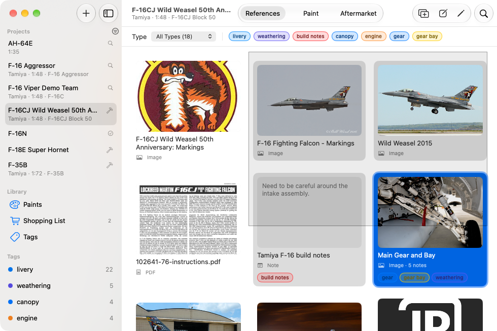

**Filter bar**: a Type menu ("All Types (18)", "Images (12)", "PDFs (2)", …)
and a chip for every tag used in the project. Clicking a chip filters by it,
and clicking again stops. When filtered: "6 of 18" and Clear.

**Tiles**, newest first:

- A picture fills the top: the image's thumbnail, a PDF's first page, a video's
  poster, a webpage's preview (or its icon at its own size, centred), or the
  start of a note's or snippet's text on a grey card.
- Under it: the title, then the kind with details ("Image · 5 notes",
  "PDF · 4 markups", "Video · 1:30", "Webpage · JetPhotos"), then tag chips.
- Selection: click, Ctrl+click to add or remove, Shift+click for a range, a
  drag across empty space for a rectangle, Ctrl+A for all.

**Opening** (double-click or Enter):

| Kind | Opens |
|---|---|
| Image | The image viewer. With several images selected (two to four), Compare. |
| PDF | The PDF viewer |
| Markdown | A preview (Quick Look on the Mac) |
| Webpage | The page in the browser |
| Video | The video in the browser, at its first moment if it has one |
| Text snippet, note | The details or note editor |

Space previews a file, as Quick Look does in Finder.

**Right-click menu** for one reference:

- Open, Quick Look, Open in Default App
- Export Marked-Up Copy… (PDFs)
- Open at 1:23, for each video moment
- Open Source Page
- Edit Details… (or Edit Note…), Edit Tags…
- Refresh Page Preview or Refresh Video Details
- Tags ▸ (the library's tags, ticked when on), Filter by Tag ▸
- Show Only Images (or the kind's plural)
- Move to Project ▸, Copy to Project ▸ (the other projects)
- Open Side by Side (images), Delete…

For several: Edit Tags…, Move to Project ▸, Copy to Project ▸, Open Side by
Side (two to four images), Delete 3 References….

**After moving or copying**, a notice at the bottom: "Moved 3 references to
F-16C.", with "Show F-16C". If some were already there: "F-16C already has 2 of
these files, so they were left as they are."

**Deleting** asks "Delete “Main Gear and Bay”?" (or "Delete 3 References?"),
then "This removes the reference and its saved copy from BenchBook. This can't
be undone."

**Empty states**: "No References. Drag images, PDFs, Markdown files, links or
text here, paste them, or use the Share menu in your browser and choose
BenchBook. You can also write your own notes." with Add Files… and New Note….
When filters hide everything: "No Matching References. No references in this
project match the type and tags you've chosen." with Clear Filters.

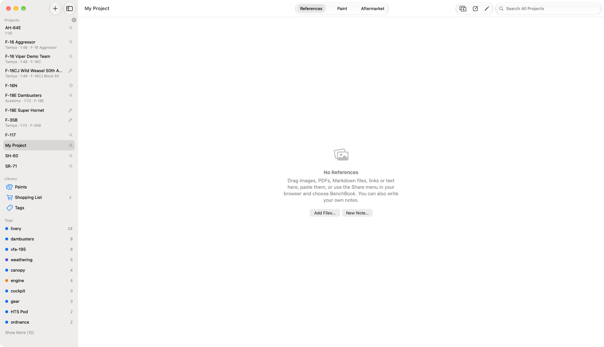

## Reference details

`Views/ReferenceDetailsView.swift`

A dialog for any reference except notes, in sections, top to bottom:

- **Reference Details**: Title (its placeholder is the fallback title), Tags
  ("Separate tags with commas") and Note ("Optional", 3 to 8 lines).
- **Text** (snippets): the captured text, selectable.
- **Video** (video links), with a Refresh button in the header ("Fetch the
  video's details and poster again"), or a spinner while fetching: the poster,
  Channel (a link when there's a channel URL), Length, Published (date only),
  and Description, collapsed. Before the first fetch: "Video details haven't
  been fetched yet. BenchBook tries again when it's online."
- **Webpage** (webpages), with Refresh ("Fetch the page's preview image and
  details again"): the preview image (64 pt with rounded corners when it's an
  icon), Site, and the description. Before the first fetch: "The page's
  preview hasn't been fetched yet. BenchBook tries again when it's online." If
  the page offered nothing: "This page doesn't offer a preview."
- **Moments** (videos that have any): each moment as a link that opens the
  video at that time. Moments come only from the timestamp in a saved link.
  There's no way to add or edit them yet.
- **Information**, each row only when there's a value: Type, Added (date and
  time), Source (a link showing the site's host), Original File (a link to the
  web address the file came from, showing the last part of the address), File
  Name (the name the file had when it was added), Size, and Dimensions
  ("1200 × 819").
- Cancel and Save. A save error shows "Couldn't Save Reference".

The Mac also has "Suggest Title and Note" (Apple Intelligence) for images,
which fills the title and note, offers suggested tags as buttons, and can be
undone. The Windows app leaves all of this out.

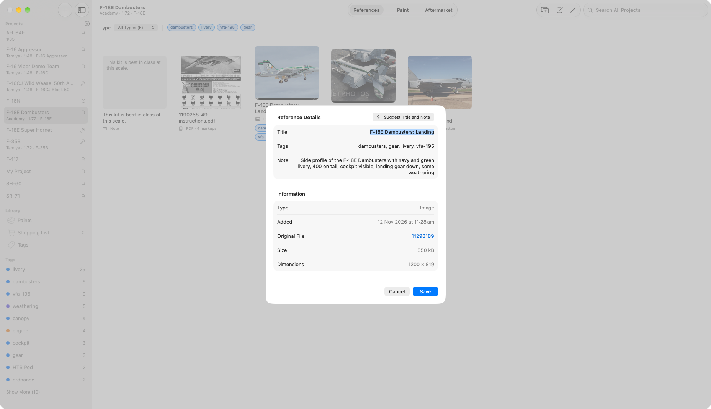

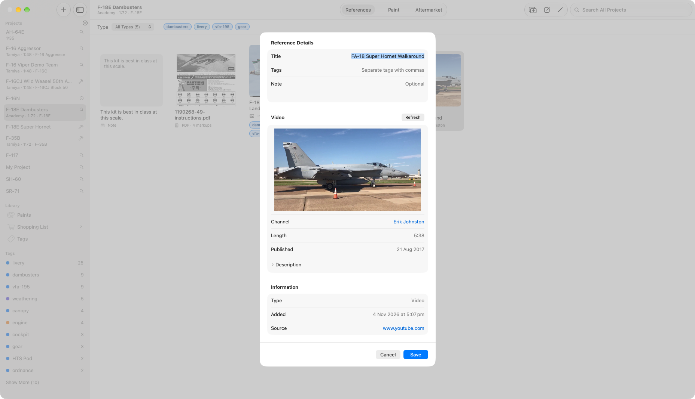

## Note editor

`Views/NoteEditorView.swift`

"New Note" or "Edit Note": "Title (optional)", a large text area ("Write your
note…", focused when the note is new) and "Tags, separated with commas". The
buttons are Cancel and Add Note (Save when editing), and Add Note stays disabled
until there's a title or some text. If the save still fails for that reason,
"Couldn't Save Note" says "Write a title or some text for the note."

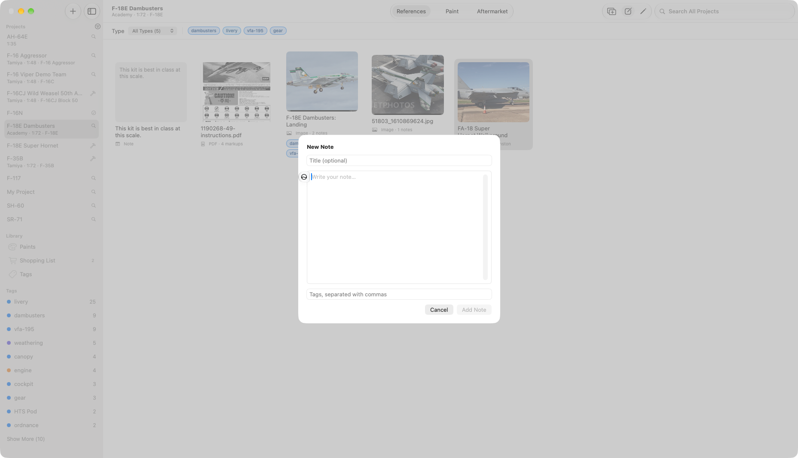

## Project editor

`Views/ProjectEditorView.swift`

"New Project" or "Edit Project": Name ("Required"), Subject ("e.g. F-16CJ
Block 50"), Markings Scheme ("Optional"), Status (a menu, each status with its
icon), and Notes ("Optional", several lines). The default status for new
projects is set in Settings.

A new project also has **Kits**: the chosen kits (picture, name, then brand,
scale and number, and a remove button), then Add from Kits… and New Kit….
Footer: "New kits go into your Kits catalogue straight away, even if you
cancel." New Project from Kit… (on the Kits screen) opens this sheet named
after the kit, with the kit chosen. An existing project changes its kits in
its Kits tab. Create (or Save) stays disabled until there's a
name: "Enter a name to save the project."

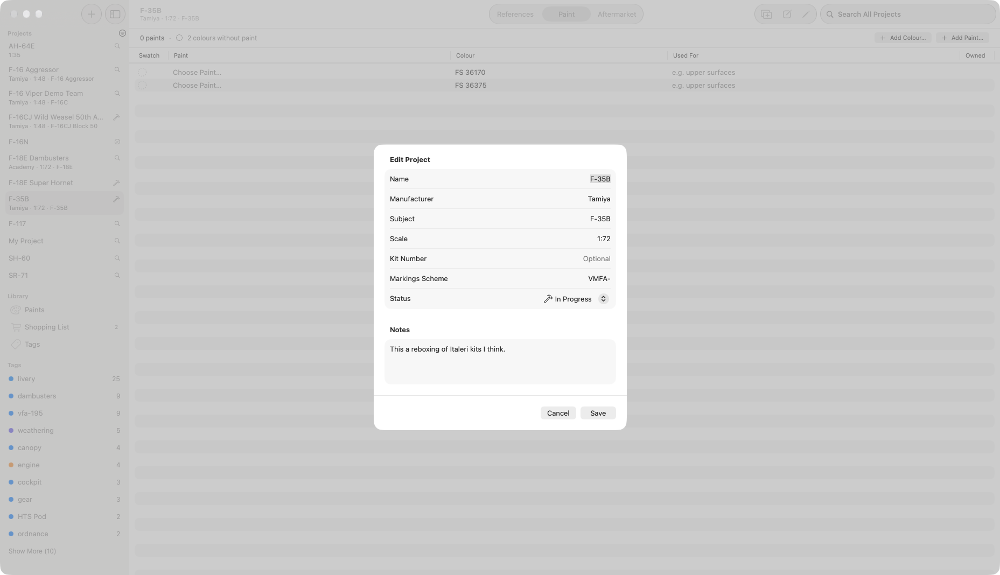

## Edit tags

`Views/Tags/ReferenceTagsSheet.swift`

"Tags for “Main Gear and Bay”" or "Tags for 3 References": the tags on them as
chips with remove buttons, an "Add Tags" field ("Type tags, separated with
commas, then press Return"), and "Add an existing tag" listing the library's
tags. With several references, a tag on only some of them shows as partly on:
"On some of these references. Click to add it to all of them." Existing tags
show in their colours. Each add or remove is saved straight away. Done (also
Escape) adds anything still typed in the field, then closes. Errors show
"Couldn't Change Tags".

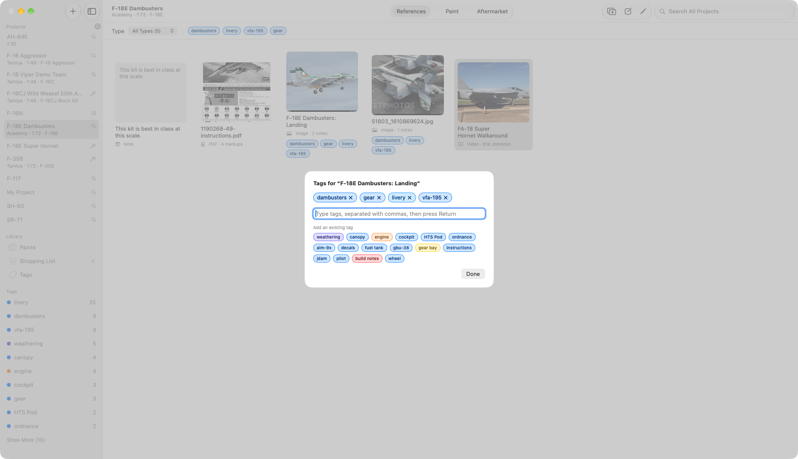

## Paint tab

`Views/Paint/ProjectPaintView.swift`

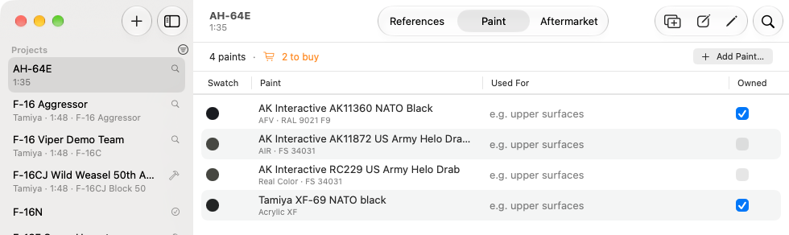

A table, in this order: Swatch, Paint (name, with range and standard
underneath), Standard (a menu of None and the standard systems, for the colour
in the painting guide), Code (the guide colour's code, shown only when a system
is chosen, with the system's prompt such as "e.g. 36270"), Used For, Notes
("e.g. lightened 20%"; "Changes for this project only, such as a lighter mix
for faded paint"), and Owned (a tick box: "You own this paint" or "You don't
own this paint yet"). A mix's Owned box can't be ticked; its help says whether
you own every paint in its recipe, or which you don't.

The line above it, with Add Colour… and Add Paint… on the right, reads "4 paints
· 2 to buy · 1 colour without paint". "To buy" counts paints you don't own,
including those in a chosen mix's recipe, not the mix. "To buy" is orange with a cart icon and
appears only when it's more than zero. So does "without paint", which has a
dashed circle. Counts use the singular for one.

- **Add Colour…** asks for a Standard (a menu, starting on FS 595, each item
  with its subjects as a hint), a Code (the system's prompt, e.g. "e.g.
  36270") and Used For ("e.g. upper
  surfaces"), with Cancel and Add Colour. Add Colour is disabled until there's
  a code.
- A colour with no paint has an empty, dashed swatch, a "Choose Paint…" button
  in the Paint column ("Choose a paint from your catalogue for this colour"),
  and no Owned tick box.
- **Add Paint…** opens the paint picker.
- Standard is changed from its menu, and Code ("e.g. 36270"), Used For
  ("e.g. upper surfaces") and Notes are edited in place. Choosing None clears the code.
- Right-click: Choose Paint… or Change Paint…, Remove from Project (or
  "Remove 3 Rows from Project").

Empty: "No Paint. Add the colours from the painting guide, such as FS 36270,
then choose a paint for each. Or add paints from your catalogue directly.",
with Add Colour… and Add Paint… buttons.

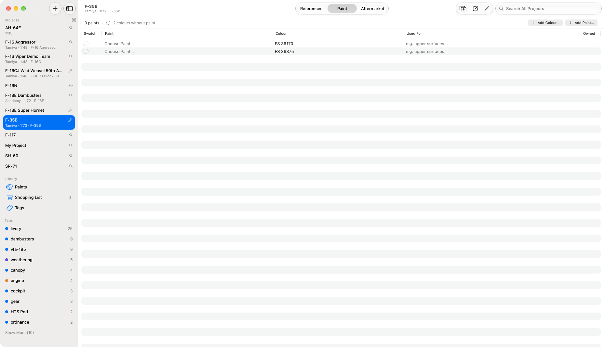

## Paint picker

`Views/Paint/PaintPickerView.swift`

"Add Paint to F-16C" (or "Choose Paint for FS 36270" when choosing for a
colour): a search field ("Search brand, code, name or standard") and a Type
menu (All Types, each type, Not Set; "Show one type of paint, such as
lacquers"), then a list of catalogue paints, each with a tick box, swatch,
name, and range and standard underneath. Paints you own say "Owned" on the
right. Paints already in the project are left out.

- Adding: tick any number of paints. The button reads "Add Paint", or "Add 3
  Paints", and is disabled until one is ticked.
- Choosing for a colour: the search starts with the colour's standard, only
  one paint can be ticked, and the button reads "Choose Paint". Paints with
  the colour's standard come first, best match first, then paints you own.
  Those paints show their match on the right ("Exact Match", or "Same
  Standard" when it isn't set). New Paint… starts with the colour's standard.
- New Paint… (bottom left) opens the paint editor. Cancel closes.

Empty: "No Paints in Catalogue. Create a paint here, or add many at once from
Paints in the sidebar.", or "No Paints to Add. Every paint is already in this
project.", or "No paint in your catalogue matches the search and type, or
every match is already in this project."

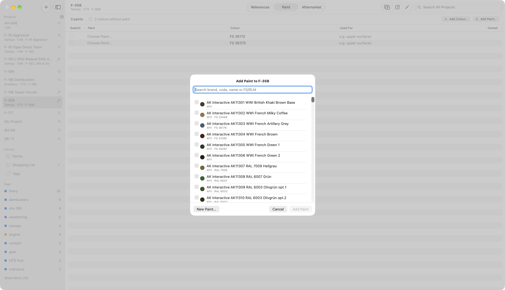

## Kits catalogue

`Views/Kits/KitCatalogueView.swift`

One row per physical kit: Picture (box art, or a box icon), Brand, Name,
Scale, Number, Status, Rating (stars), Project (the project using it, with
"Needed for Cobra" as its tooltip when it's needed), Price Paid, For Sale (a
tick box) and Sale Price. Kits that aren't owned show "Not Owned" in Status. Prices are in
the device's currency format. Every column sorts; right-click a heading to
hide columns, except Brand and Name. The title bar counts entries: "116 kits ·
4 not owned", or "12 of 116 kits · 4 not owned" while filtered.

Toolbar: Brand ▸ ("All Brands", "Italeri (12)"), Scale ▸, Status ▸ ("Any
Status", "WIP (3)", counting owned kits only), a Show menu (All Kits, Owned,
Not Owned, For Sale, Not in a Project, Needed), Import CSV…, Export CSV…, Add Kit.

- Double-click to edit. Right-click one kit: Edit Kit…, Add Another Copy,
  Open Link (when it has one), Show Project (in a project) or New Project
  from Kit… (in none), Status ▸, Mark as Owned or Not Owned, Mark as For Sale
  or Not For Sale, Move to Project ▸ (every project by name; the kit's own is
  dimmed), Remove from Project (in a project), Delete Kit…. With several
  selected, the status, owned, sale, move, remove and delete commands apply to
  all of them ("Delete 3 Kits…", "Remove 2 Kits from Projects").
- Delete asks "Delete “Italeri 1:72 Super Cobra (1234)”?" or "Delete 3 Kits?":
  "This removes the kit and its picture from BenchBook. This can't be undone."
  For kits in a project, that starts with "It's used by the project “Cobra”."
  or "They're used by the projects “Cobra” and “Spitfire”."
- Import shows "Added 3 Kits and Updated 1" (or "Added 3 Kits", "Updated 1
  Kit", "No Kits Added"), then "Already in your catalogue: 110.", "Skipped 27
  rows for things other than kits: Markings (Decals) 22, Detail and Conversion
  sets 5.", and up to ten problems.
- Export asks first: "116 kits will be saved, one row per kit, with
  details, status, rating, prices and links, in a CSV file BenchBook can
  import. Pictures aren't included; a backup has them.", with "Include notes",
  off.

Empty: "No Kits. Add the kits in your stash, and the ones you want, or import
a Scalemates stash export. Each box is its own entry, with its own status.",
with Add Kit and Import CSV…. Nothing matching the filters: "No Matching Kits.
No kits match the chosen brand, scale, status and ownership.", with Show All
Kits.

## Kit editor

`Views/Kits/KitEditorView.swift`

"New Kit" or "Edit Kit": Brand ("e.g. Italeri"), Name ("e.g. Super Cobra"),
Scale ("e.g. 1:72"), Number ("Optional"); Owned, Status (BNIB, Opened, WIP,
Built; dimmed while Owned is off, with "Kits you don't own yet have no
status."), Rating (five stars); Link ("Scalemates, a shop or the maker");
Price Paid (an example in the device's currency), For Sale, Sale Price
(dimmed while For Sale is off); the picture, as in the aftermarket editor,
with "Use Image from Product Page" using Link; and Notes.

- **Rating**: click a star to set it, click the same star to clear it. With
  keyboard focus, the arrow keys step it and 0–5 set it. VoiceOver reads it
  as an adjustable "Rating", e.g. "3 stars" or "No rating".
- **Same kit**: under the first section, "You already have 2 of this kit.
  This adds another." for a new kit, or "You have 1 more of this kit." when
  editing. It never stops Save.
- Save needs a brand and a name. A bad link shows "Enter a web address, such
  as scalemates.com/kits/…"; a bad price shows "Enter prices as numbers, such
  as 18.50.".
- Dropping a link on the picture fills in Link if it's empty.

## Project Kits tab

`Views/Kits/ProjectKitsView.swift`

The kits this build uses. A header: "2 kits · 1 not owned", Add from Kits…
("Choose kits for this build from your Kits catalogue") and New Kit… ("Add a
kit to your catalogue and to this build"). A table: Picture, Kit (name, with
brand and number underneath; notes as a tooltip), Scale, Status (a menu for
owned kits, "Not Owned" otherwise) and Link.

- Double-click to edit. Right-click: Edit Kit…, Show in Kits, Open Link,
  Status ▸ (owned kits), Remove from Project ("Remove 2 Kits from Project").
  Delete removes from the project without asking; the kits stay in the
  catalogue.
- **Add from Kits…** opens "Add Kits to Cobra": a search field ("Search
  brand, name, scale or number") and kits that aren't in a project, by brand
  and name, each with a tick box, picture, name, brand · scale · number, and
  its status or "Not Owned". New Kit… adds one to the catalogue and ticks it.
  "Add Kit" or "Add 3 Kits". With none: "No Kits to Add. Every kit in your
  catalogue is already in a project. Add a new one here, or import your stash
  from Kits in the sidebar." With no match: "No Matching Kits. No kit that
  isn't already in a project matches “…”."

Empty: "No Kits. Choose the kits for this build from your Kits catalogue, or
add a new one.", with Add from Kits… and New Kit….

## Paints catalogue

`Views/Paint/PaintCatalogueView.swift`

A table: Swatch, Brand, Range, Code, Name, Standard ("FS 36270"), Match, Type
(with the type's hint as help), Owned, Projects. The text columns sort, in
natural order; Match sorts Exact, Closest, No Match, then Not Set; Type sorts in
menu order with Not Set last. A mix's Name has "Mix" after it, with its recipe
as help, and its Owned box can't be ticked. Above it: Brand ▸, Range ▸ and Type ▸ menus
("Tamiya (286)", "Lacquer (40)", "Not Set (900)"; the label reads "Type Not
Set" when that's chosen), Owned Only,
and the count ("286 of 1,267 paints · 40 owned"). Toolbar: Import CSV…,
Export CSV…, Add Mix (a flask; "Add a custom mix, with a recipe of paints from
the catalogue"), Add Paint.

- Double-click to edit. Right-click: Edit Paint… (Edit Mix… for a mix), Mark
  as Owned or Not Owned (for the selected paints that aren't mixes),
  Delete Paint… (or "Delete 3 Paints…").
- Deleting a paint used in a project or a recipe is refused: "Paints used in a
  project or a mix's recipe can't be deleted until they're removed from it."
- Import shows "Imported 120 Paints", with "6 were already in your catalogue
  and were skipped." and up to ten problems ("…and 4 more problems.").
- Export asks first: "1,267 paints will be saved, with brand, range, code,
  name, standard, match, type and colour, in a CSV file another BenchBook can
  import. Mixes aren't included. Leave
  ownership and notes out when sharing.", with "Include whether you own each
  paint" and "Include notes", both off.

Empty: "No Paints. Add the paints you use, or import a CSV file with Brand,
Range, Code, Name, Standard, Type, Colour and Owned columns." With filters
that hide everything: "No Matching Paints. No paints match the chosen brand,
range, type and ownership.", with Show All Paints.

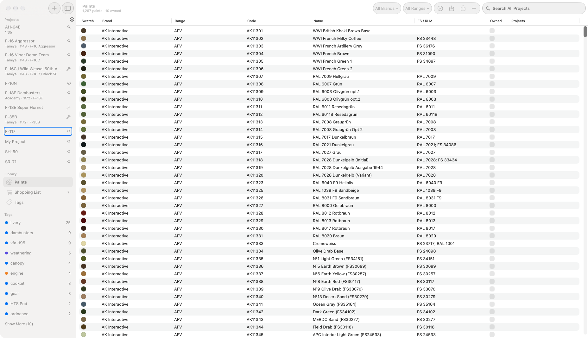

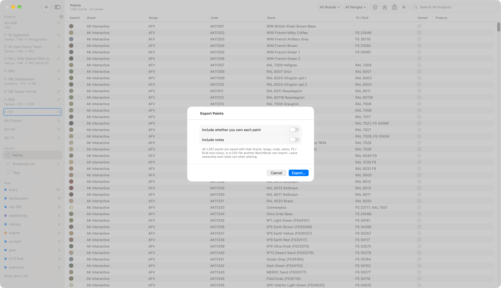

## Paint editor

`Views/Paint/PaintEditorView.swift`

"New Paint" or "Edit Paint": Brand ("Required, e.g. Tamiya"), Range
("e.g. Acrylic XF"), Code ("Required, e.g. XF-54"), Name ("e.g. Dark Sea
Grey"), Type (Not Set, then the types, each with its hint; the menu's help is
the chosen type's hint, or "What the paint is made with, so you use the right
thinner").

Colour Standard section: Standard (None, then the systems, each with its
subjects as a hint). With a system chosen, Standard Code with the
system's prompt, such as "e.g. 36270" or "e.g.
FS 36375 / BS 637", and Match (Not Set, No Match, Closest Match, Exact Match;
"How closely this paint matches the standard"). With None, the footer reads
"Most paints don't follow a standard. Choose one when you use this paint for
a standard colour, such as FS 36270."

Then Show a Swatch with a "Swatch Colour"
picker and a preview of the swatch (glass for clears), "I Own This Paint", and Notes ("Optional, e.g. thin 1:1 with X-20A").
Under the swatch: "The swatch only helps you recognise the paint on screen; it
isn't an accurate colour match."

**Mixes**: "New Mix" or "Edit Mix". Brand ("Required, e.g. Custom or your
name"), Code ("Optional"), Name ("Required, e.g. Faded Sky Grey") and Type;
there's no Range. Then a Recipe section: one row per paint, with its swatch,
name, a parts field with "part" or "parts", up and down arrows ("Move
Tamiya XF-2 Flat White up the recipe"; dimmed at the top and bottom), and a
remove button ("Take Tamiya XF-2 Flat White out of the recipe"). Add
Paints… ("Choose catalogue paints for this mix") opens Add Paints to Recipe.
The footer reads, as fits:

- "Add the paints you mix, with how many parts of each. Changes for one
  project go in that project's notes for the colour."
- "You own every paint in this recipe, so the mix counts as owned."
- "Not owned yet: Tamiya XF-19 Sky Grey. Projects using this mix put them on
  the Shopping List."
- "Each paint needs a number of parts more than zero.", and Add or Save is
  disabled.

Then Colour Standard and the swatch, as for a paint, without "I Own This
Paint". Without a brand and name: "Enter a brand and a name to save the mix."

**Add Paints to Recipe**: a search field ("Search brand, code, name or
standard") and the catalogue's paints that aren't mixes or already in the
recipe, each with a tick box, swatch, name, details and "Owned". Cancel, and
Add Paint (or "Add 3 Paints"), which adds each with 1 part. Empty: "No Paints
in Catalogue. Add the paints you mix to your catalogue first, from Paints in
the sidebar.", or "No Matching Paints. No paint that isn't already in the
recipe matches the search."

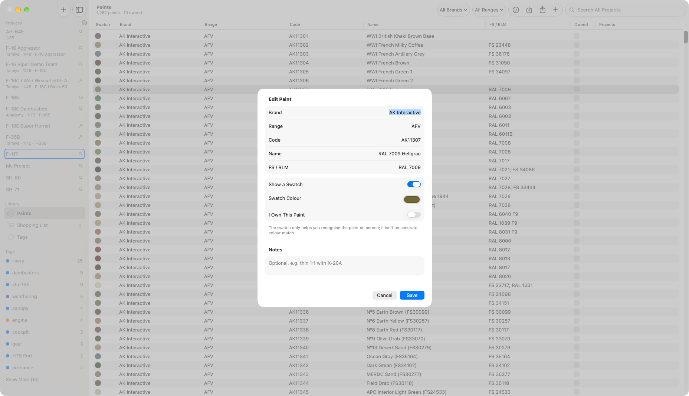

## Shopping list

`Views/Paint/ShoppingListView.swift`

The header counts what's left, such as "1 kit · 2 paints for 1 project ·
4 colours without paint". First, **Kits**: each needed kit with a Bought tick
box ("Mark as bought: it's owned, BNIB, and off the list"), its picture, name,
brand · scale · number, and its project. Right-click: Mark as Bought, Show in
Kits, Show Project. Then paints, grouped by brand. Each paint shows its swatch, code and name, range and
standard, and the projects that need it, with an Owned tick box that takes it
off the list ("Mark as owned and take it off the list"). Right-click: Mark as
Owned, Show in Paints. Then "No Paint Chosen": each colour without a paint,
with an empty swatch, its standard, and the project that needs it (with the
colour's "used for" text in brackets when it has one). These rows have no button, only
the tooltip "Choose a paint for this colour on the project's Paint tab". The
toolbar has Export Shopping List… ("Save the shopping list as a text file").

Empty: "Nothing to Buy. Kits and paints you don't own that a project needs
appear here, with colours that have no paint chosen yet. Completed projects
aren't included."

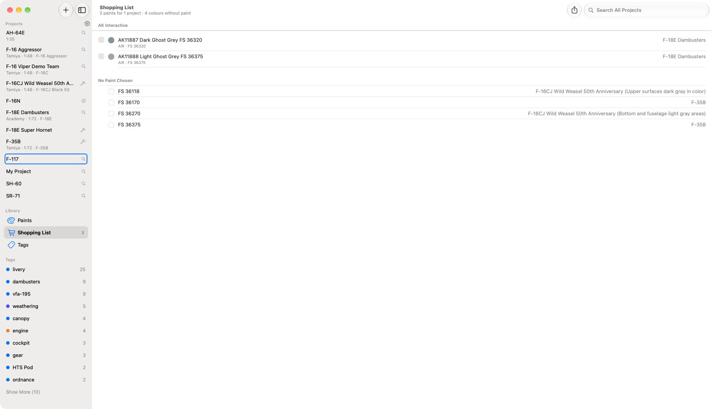

## Aftermarket tab

`Views/Aftermarket/ProjectAftermarketView.swift`

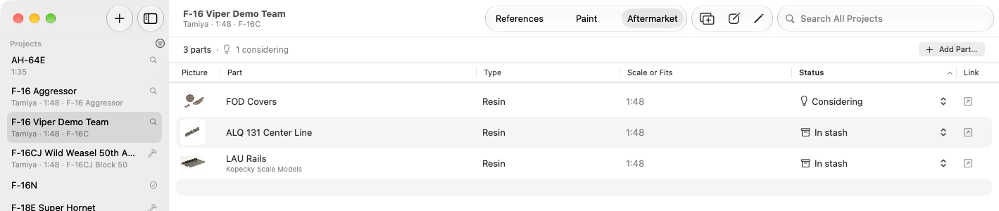

A table: Picture, Part (name, with manufacturer and number underneath), Type,
Scale or Fits, Status (a menu in the row), and Link (opens the product page).
The header line: "3 parts · 1 considering". Add Part… is on the right.

Right-click: Edit…, Open Product Page, Delete Part…. Deleting: "Their details
and pictures are removed from this project."

Empty: "No Aftermarket Parts. Keep track of decals, resin, photo-etch and other
parts you're using or considering for this build."

## Aftermarket editor

`Views/Aftermarket/AftermarketEditorView.swift`

"New Part" or "Edit Part": Name ("e.g. 50th Anniversary 2015"), Manufacturer
("e.g. Galaxy Models"), Product Number ("Optional"), Type (a menu), Status (a
menu, each status with its icon), Scale or Fits ("e.g. 1:48, Tamiya F-16C",
starting with the project's scale), Product Page ("https://…"), and Notes
("Optional").

**Picture**: drop an image, Choose Image…, "Use Image from Product Page"
(disabled until there's a product page: "Enter the product page first"), and
Remove Image. While the editor is in front, File › Import from iPhone or iPad
› Take Photo makes the photo the picture; like a dropped one, it's kept only
on Save. A product page that isn't a web address: "Enter a web address,
such as hannants.co.uk/product/…".

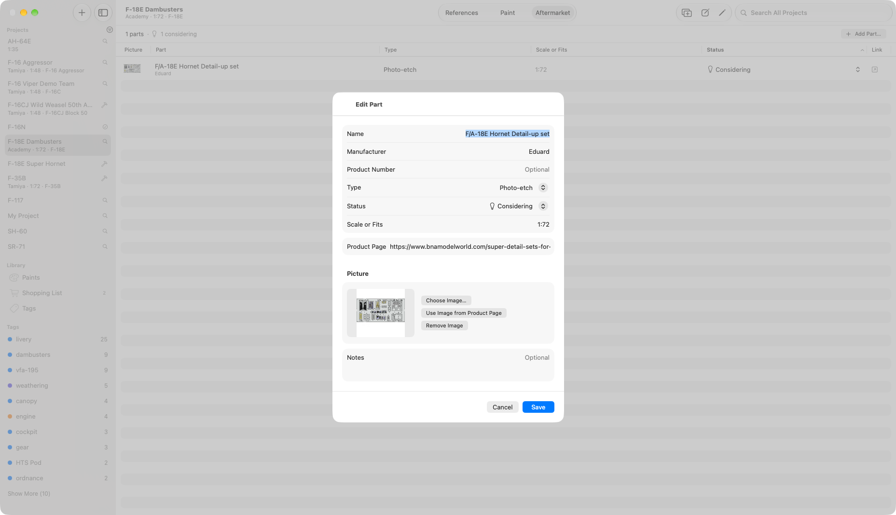

## Build Photos tab

`Views/BuildPhotos/BuildPhotosView.swift`

The user's own photos of the build. A grid of tiles in groups: **Completed**
first, then work in progress by day ("Thursday, 19 November 2026"), each
group headed by its name and count. Each tile shows the photo, its caption
(the first line of its notes) or its date taken, then the stage with its
icon (hammer for WIP, seal for Completed), the time when there's a caption,
and "2 notes" when it has box notes, then its tags. The project photo has a
star in its corner.

- Double-click or Return opens the image viewer; Space shows Quick Look.
  Opening one of 2–4 selected photos opens them side by side.
- Selection works as in References: click, ⌘-click, ⇧-click, a drag across
  empty space for a rectangle, and Select All. Delete asks to delete the
  selected photos.
- Right-click one photo: Open, Quick Look, Open in Default App, Edit
  Details…, Mark as Completed (or Mark as WIP), Set as Project Photo (or
  Remove as Project Photo), Tags ▸, Export…, Delete….
- Right-click several: Open Side by Side, Mark as Completed, Tags ▸, Export 3
  Photos…, Delete 3 Photos….
- Deleting asks "Delete This Photo?" or "Delete 3 Photos?", with
  "This removes the photo, its notes and its saved copy from BenchBook. This
  can't be undone."
- **Export…** asks for a folder ("Choose a folder for the 3 exported
  photos."), with a **Remove location data** checkbox, on by default.

Adding: drop or paste onto the section, Add Photos…, Import from Photos…, or
File › Import from iPhone or iPad › Take Photo.
Anything that isn't an image: "“name” isn't a photo." The same photo twice:
"Already in Build Photos" or "“name” is already in this project's build
photos."

Empty: "No Build Photos. Drop photos here, choose Add Photos…, or take one
with your iPhone using File › Import from iPhone or iPad. Keep
progress shots and photos of the completed model here, apart from your
references." with Add Photos… and Import from Photos….

There's no screenshot yet.

## Build photo details

`Views/BuildPhotos/BuildPhotoDetailsView.swift`

"Build Photo Details": the photo, Stage (WIP / Completed), Taken (date and
time), Notes ("Notes (optional). The first line shows under the photo."),
Tags ("Tags, separated with commas"). Cancel and Save. Error alert: "Couldn't
Save Build Photo".

## Tags

`Views/Tags/TagManagerView.swift`, `Views/Tags/TagNameSheet.swift`

A table: Colour, Name, Used By ("12 references, 4 build photos", or "Not
used"), Projects. "12 tags" in the header. Toolbar: New Tag, Remove Unused
Tags (disabled with "Every tag is in use").

- Right-click: Show Tagged Items, Rename…, Colour ▸, Merge 3 Tags…, Delete Tag….
- Merging asks which to keep ("Keep “cockpit”"), with "References and build
  photos with any of these tags will have the one you keep. The others are
  deleted."
- Renaming to an existing name asks "Merge the two tags? References and build
  photos tagged with either will have “cockpit”."
- Deleting: "They'll be removed from 14 references. The references themselves
  aren't deleted." With build photos too: "They'll be removed from 14
  references and 3 build photos, which aren't deleted."

Clicking a tag in the sidebar shows every reference and build photo with it,
grouped by project, in the same layout as search results. If none: "Nothing
has this tag yet. Drag references or build photos onto it in the sidebar."

Empty: "No Tags. Tags you add to references and build photos appear here,
where you can rename, colour, merge and delete them."

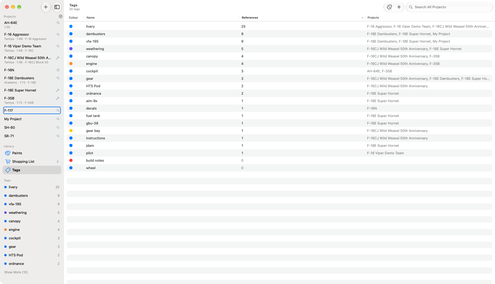

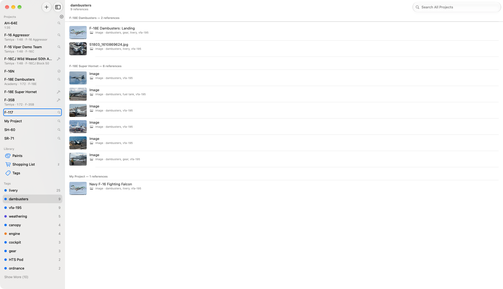

Each group is headed "Project — 2 references" or "Project — 2 references,
1 build photo" (see Counts at the top).

## Search

`Views/Search/SearchResultsView.swift`

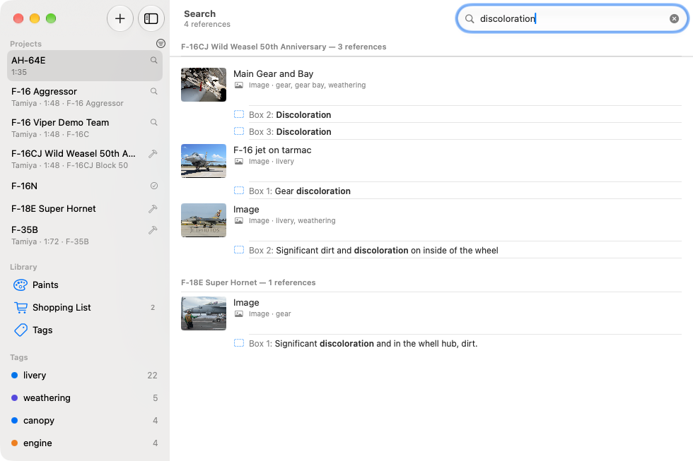

The search field replaces the project with results: "Search · 4 references".
Sections for Projects, Kits, Paints and Aftermarket, then references grouped by
project ("F-16CJ Wild Weasel 50th Anniversary — 3 references"). Each reference
shows its thumbnail, title, kind and tags, then a line for each part that
matched ("Box 2: **Discoloration**"). Clicking a box, markup or moment line
opens the image, PDF or video at that spot.

Right-click: Open, Show in Project, Edit Details…, Export Marked-Up Copy…
(PDFs). Kits: Edit Kit…, Show in Kits; each shows its box art, brand and
name, scale, number and notes, and its status or "Not Owned". Paints: Edit
Paint…, Show in Paints. Parts: Edit Part…, Show in Project.

Build photos come after a project's references, each with its thumbnail,
caption or date, "Build Photo · WIP" and its tags, and a line per matching
box ("Box 1: Seat belts") that opens the photo at that box. Right-click:
Open, Show in Project, Edit Details…. The subtitle adds "2 build photos".

## Image viewer

`Views/ImageViewer/ImageViewerWindow.swift`, `ImageCanvas.swift`, `ImageNotesPanel.swift`, `ImageInfoPanel.swift`

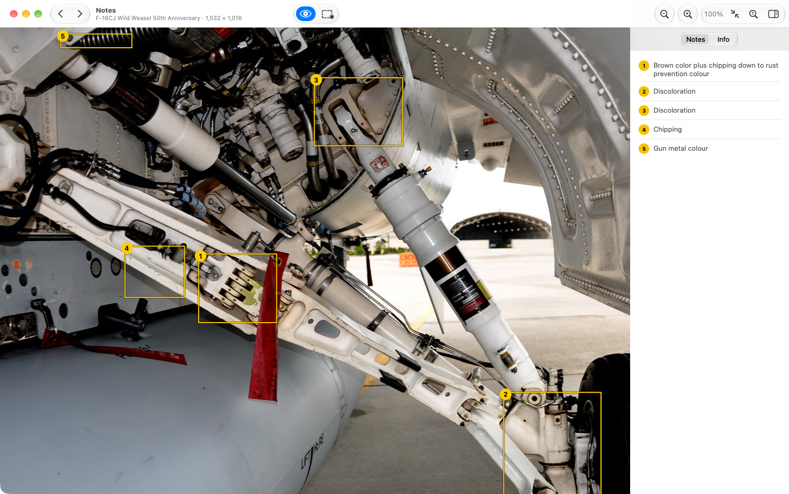

Its own window. The title is the reference's title, with a subtitle like
"F-16CJ · 4,032 × 3,024".

- **Toolbar**: Previous and Next Image (in this project), Show/Hide Boxes,
  Draw Box, zoom out, the zoom percentage, zoom in, Zoom to Fit, Actual Size,
  and Notes and Info.
- **Canvas**: the original image. Scroll or pinch to zoom, drag to pan. Boxes
  are numbered outlines. With Draw Box on, drag to make a box. Select a box to
  move it or drag a corner to resize it.
- **Side panel**, with Notes and Info tabs:
  - Notes: a numbered list, each with a text field ("Describe this feature")
    and Delete Note…. Selecting one selects its box. Empty: "No Notes. Choose
    Draw Box, then drag across a feature of the aircraft to mark it and add a
    note."
  - Info: Image (Format, Dimensions, Megapixels, Colour, Bit Depth, Resolution,
    Transparency), Camera (Camera, Lens, Taken, from EXIF), Source (Added, File
    Name, Size, Page) and Tags.
- A very large image may be shown smaller: "Shown at 8,000 × 6,000 because the
  original is larger than the display can handle. The original is unchanged."
- Deleting a note: "Delete Note? The box and its note will be removed. The
  image isn't changed."

## Compare

`Views/ImageViewer/ImageComparisonWindow.swift`

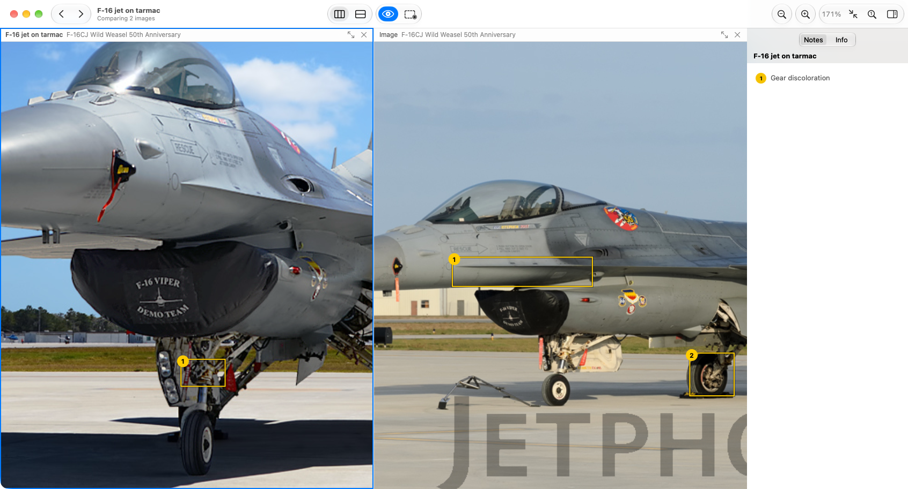

"Comparing 3 images". Each image zooms and pans on its own and shows its boxes.
The toolbar has Side by Side or Grid, zoom for the selected image,
Show/Hide Boxes for all of them, Draw Box on the selected one, and Notes and
Info. On each image: Previous and Next (replaces it with another image from the
project), Show only this image (or double-click it), and Remove from
Comparison. Drag more images in from the grid, up to four: "Drop images here to
compare them too."

## PDF viewer

`Views/PDFViewer/PDFViewerWindow.swift`, `PDFCanvas.swift`, `PDFMarkupsPanel.swift`

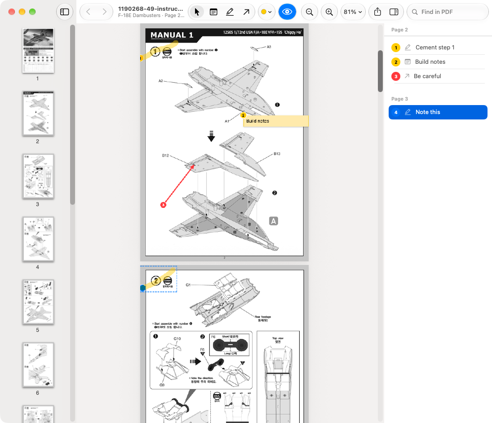

Its own window. Subtitle: "F-16CJ · Page 3 of 12 · 2 of 7 found".

- **Toolbar**: Previous and Next PDF, the tool (Select, Note, Highlight,
  Arrow), Colour, Show/Hide Markups, zoom (with Zoom to Fit and Actual Size
  in its menu), Find, Export Marked-Up Copy…, and Markups.
- **Thumbnails** of the pages on the left.
- **Pages** in a continuous scroll. Note: click to place, then type. Highlight:
  drag along the text; hold Shift for a straight line. Arrow: drag from the
  tail to the tip. Esc goes back to Select. In Select, drag a markup to move it,
  and right-click it for Edit Text, Colour ▸ and Delete Highlight….
- **Markups panel** on the right, grouped by page ("Page 3"), each numbered
  with its kind, colour and a text field ("Write a note", "Describe this
  highlight", "What does it point to?"). Empty: "No Markups. Choose Note,
  Highlight or Arrow in the toolbar, then click or drag on a page."
- **Find**: "2 of 7 found" or "Not found", with Previous and Next Match.
- A password-protected PDF: "This PDF is protected with a password, so
  BenchBook can't show it. Use Open in Default App instead."
- Exporting saves "Title (Marked Up).pdf".

*The screenshot shows empty "Describe this highlight" placeholders. A retake
with text in them would be better.*

## Settings

`Views/SettingsView.swift`

On the Mac, a window with General, Library and Backup tabs. On Windows, a
Settings page.

**General**

- Links: "Fetch webpage previews and video details automatically", explained as
  "After you save a webpage or a YouTube or Vimeo link, BenchBook reads the page
  for its preview image, title and description, or the video's poster, channel
  and length. This is the only time BenchBook goes online on its own. When it's
  off, use Refresh on a link to fetch its details."
- Image Viewer: Open images at Fit to Window or Actual Size; Show note boxes
  when an image opens.
- Projects: Status for new projects (a menu, each status with its icon).
- The Mac also has an Apple Intelligence section ("Suggest titles and notes for
  new images"), between Links and Image Viewer. Windows leaves it out.
- Safari (Mac only), last: "Safari extension" On, Off or Unknown, and Open
  Safari Extension Settings…, explained as "Save pages, images, PDFs and
  highlighted text to a project from Safari's right-click menu or toolbar.
  Turn the extension on in Safari's settings, and allow it on the websites you
  save from." With Safari older than 18.4: "This Mac has Safari 18.3. The
  extension needs Safari 18.4 or later, which comes with macOS 15.4 and later."

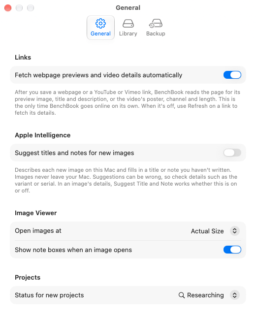

**Library**

- Location: the library folder's full path (blurred in the screenshot), with
  Show in Finder.
- Space Used, in this order: Saved files, Thumbnails, Posters and previews,
  and Total (in bold).
- Maintenance: "Remove unused files" with Clean Up Now ("Deletes saved files
  and previews that nothing uses any more, such as leftovers from an
  interrupted import. BenchBook also does this at launch."), and "Clear
  thumbnails" with Clear Thumbnails ("Deletes the gallery's thumbnails. Each is
  made again from its file when it's next shown.").

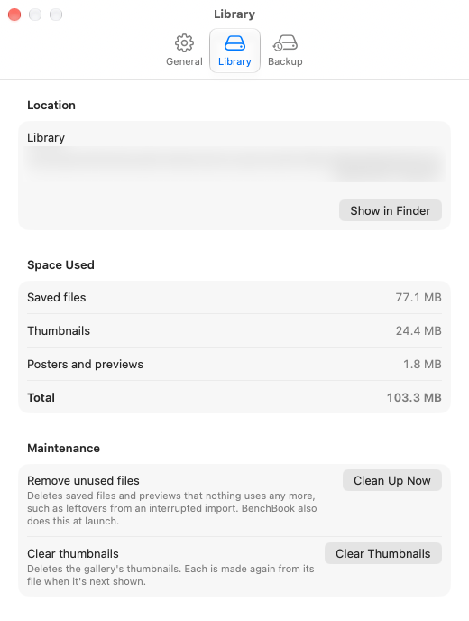

**Backup**

- Back Up Library…: "Saves every project, reference, note, paint and original
  file into one file. Keep it on another drive or in cloud storage." Shows
  "Last backed up 13 November 2026 at 09:41." or "Not backed up yet."
- Restore from Backup…: "Replaces this library with the backup. BenchBook checks
  the backup first, then quits and reopens to finish. The library you have now
  is kept." It asks "Restore the Backup from 12 November 2026 at 18:02?", with
  what it holds, and offers Restore and Reopen.
- While a backup is being checked: a spinner with "Checking the backup…".
- Kept from Before a Restore, only when there are any: each earlier library by
  folder name, with Show in Finder and Move to Trash…, and "Each is the whole
  library as it was before a restore. Keep it until you're sure the restore has
  everything."

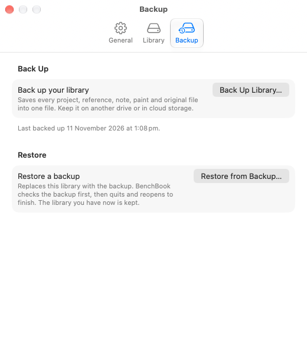

## Share sheet

`BenchBookShare/ShareView.swift`

"Add to BenchBook": the items being shared, a Project menu (starting with the
project last open in BenchBook), Tags ("e.g. wheel well, cockpit"), Note, and
Cancel or Add. Under it: "Items are added when BenchBook is open." With no
projects: "No Projects. Open BenchBook and create a project, then share again."
Items it can't take: "Can't add: name. BenchBook can save images, PDFs,
Markdown files, web links and text."

There's no screenshot: macOS shows this inside the sharing app's window. On
Windows it's the Share target window (see
[windows-app.md](windows-app.md#capture)).

## Safari extension

`WebExtension/` (shared web code), `BenchBookSafari/` (the native part)

- **Right-click menu**: Save Page to BenchBook, Save Image to BenchBook, Save
  Selection to BenchBook.
- **Notice**, in the page's top-right corner for 5 seconds (12 for a failure,
  and not while the pointer is over it), with a symbol, a headline, a detail
  line, Change… and a close button:
  - "Saving to BenchBook…", with what's being saved;
  - "Saved to *project*" with what was saved, and Change…;
  - "Already in *project*", and Change…;
  - "Sent to BenchBook" and "BenchBook will show what happened when it has
    saved it.";
  - "Couldn't save" and the reason, such as "The website didn't allow the file
    to be downloaded (error 403)."
- **Change…** replaces the notice with "Change where it's saved" (or "Save to
  another project" after a duplicate), what was saved, the Project, Tags and
  Note fields, and Cancel and Save. Tags suggests the library's tags as you
  type. ⌘Return saves; Escape closes.
- Where Safari doesn't allow the notice (its own pages, or websites the
  extension isn't allowed on), the toolbar button's badge shows ✓, = or !, and
  its tooltip says what happened.
- **Toolbar panel**, "Save to BenchBook": the page's title and "Web page ·
  *site*" or "PDF · *site*", Project (starting with the last one used), Tags,
  Note, and Save. Then "Saved to *project*." and it closes, "Already in
  *project*.", or the reason it couldn't save. On a page that isn't a website:
  "Open a web page to save it to BenchBook." With no projects: "There are no
  projects yet. Open BenchBook, make a project, then try again."

There's no screenshot yet. The notice and panel follow light and dark mode.

## Library error

`App/BenchBookApp.swift`

If the store can't be opened: "Can't Open Your Library", the error, "BenchBook
didn't change any of your data. Quit and reopen the app to try again." and
Show Library in Finder.
