# Screens

What each screen shows, what it does, and what it says. The screenshots are
from BenchBook for Mac. They show the layout and content, not the look: the
Windows app uses Windows controls (see
[windows-app.md](windows-app.md#screens)).

Each section names the Swift file that builds the screen. When this page
doesn't answer a question, such as the exact wording of a rare error, that
file is the reference. The repo is public.

Wording: keep the meaning and tone of every message. Change it only where
Windows has its own words, such as Explorer for Finder, Recycle Bin for Trash,
and Ctrl for ⌘. The Mac uses British English ("colour"), and so does Windows.

Counts: use the singular for one ("1 reference", "1 note"). A few Mac strings
don't yet, and show "1 references", "1 notes", "1 markups", "1 paints" or "1
parts": the tile's note and markup counts, search and tag group headings, the
search summary, the Aftermarket tab's header, and the sidebar tag count read by
VoiceOver. Those are Mac bugs, not wording to copy.

## Main window

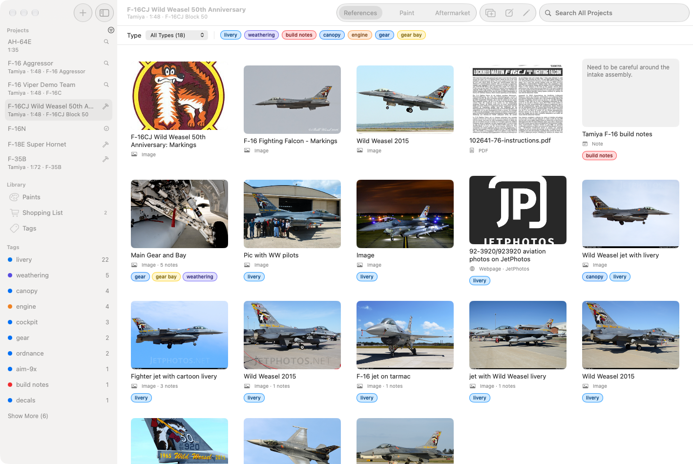

`Views/ContentView.swift`, `Views/ProjectSidebar.swift`, `Views/ProjectWorkspaceView.swift`

**Sidebar**, from top:

- **Projects**: each project's name, with its summary underneath
  ("Tamiya · 1:48 · F-16CJ Block 50"), and its status as a small icon on the
  right: magnifying glass for Researching, hammer for In Progress, pause for
  Paused, tick for Completed. A filter button in the header shows one status
  ("Projects · In Progress") or all of them. If none match: "No In Progress
  Projects", with "Show All Projects".
- **Library**: Paints, Shopping List (with the number of paints to buy), Tags.
- **Tags**: the ten most used tags with their colour and count, then
  "Show More (6)" or "Show Less".
- A + button above the list adds a project.

Right-click a project: Edit Project…, Delete Project…. Right-click a tag:
Show References, Rename…, Colour, Manage Tags…, Delete Tag….

**Dragging onto the sidebar**:

- Files, links or text dropped on a project are added to it, without selecting it.
- References dragged from the grid onto another project move there. Holding
  Option copies them instead. Windows: hold Ctrl to copy, as in Explorer.
- References dragged onto a tag get that tag. A tag dragged onto references
  in the grid tags them.

**Project header**: name and summary, then the References / Paint / Aftermarket
switch, then Add Files, New Note and Edit Project buttons, then the search field
("Search All Projects").

**Empty states**:

- No projects: "No Projects. Create a project for each build to keep its
  references, paint and aftermarket parts together." with New Project.
- No project selected: "No Project Selected. Select a project in the sidebar."
- A tag that no longer exists: "Tag Not Found. This tag may have been deleted
  or merged."

**Deleting a project** asks "Delete “F-16C”?", then "Its 12 references,
3 image notes and 2 aftermarket parts will be deleted. Paints in your catalogue
and your tags are kept. This can't be undone." For an empty project: "The
project is empty. …"

## References tab

`Views/ReferencesView.swift`, `Views/ReferenceTile.swift`, `Views/ReferenceFilterBar.swift`

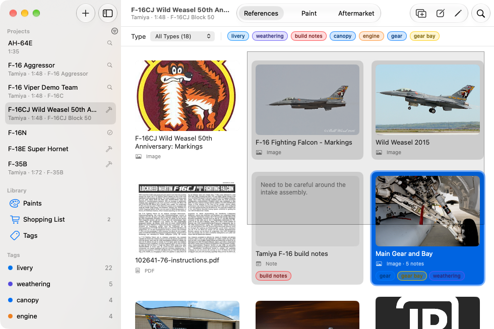

**Filter bar**: a Type menu ("All Types (18)", "Images (12)", "PDFs (2)", …)
and a chip for every tag used in the project. Clicking a chip filters by it,
and clicking again stops. When filtered: "6 of 18" and Clear.

**Tiles**, newest first:

- A picture fills the top: the image's thumbnail, a PDF's first page, a video's
  poster, a webpage's preview (or its icon at its own size, centred), or the
  start of a note's or snippet's text on a grey card.
- Under it: the title, then the kind with details ("Image · 5 notes",
  "PDF · 4 markups", "Video · 1:30", "Webpage · JetPhotos"), then tag chips.
- Selection: click, Ctrl+click to add or remove, Shift+click for a range, a
  drag across empty space for a rectangle, Ctrl+A for all.

**Opening** (double-click or Enter):

| Kind | Opens |
|---|---|
| Image | The image viewer. With several images selected (two to four), Compare. |
| PDF | The PDF viewer |
| Markdown | A preview (Quick Look on the Mac) |
| Webpage | The page in the browser |
| Video | The video in the browser, at its first moment if it has one |
| Text snippet, note | The details or note editor |

Space previews a file, as Quick Look does in Finder.

**Right-click menu** for one reference:

- Open, Quick Look, Open in Default App
- Export Marked-Up Copy… (PDFs)
- Open at 1:23, for each video moment
- Open Source Page
- Edit Details… (or Edit Note…), Edit Tags…
- Refresh Page Preview or Refresh Video Details
- Tags ▸ (the library's tags, ticked when on), Filter by Tag ▸
- Show Only Images (or the kind's plural)
- Move to Project ▸, Copy to Project ▸ (the other projects)
- Open Side by Side (images), Delete…

For several: Edit Tags…, Move to Project ▸, Copy to Project ▸, Open Side by
Side (two to four images), Delete 3 References….

**After moving or copying**, a notice at the bottom: "Moved 3 references to
F-16C.", with "Show F-16C". If some were already there: "F-16C already has 2 of
these files, so they were left as they are."

**Deleting** asks "Delete “Main Gear and Bay”?" (or "Delete 3 References?"),
then "This removes the reference and its saved copy from BenchBook. This can't
be undone."

**Empty states**: "No References. Drag images, PDFs, Markdown files, links or
text here, paste them, or use the Share menu in your browser and choose
BenchBook. You can also write your own notes." with Add Files… and New Note….
When filters hide everything: "No Matching References. No references in this
project match the type and tags you've chosen." with Clear Filters.

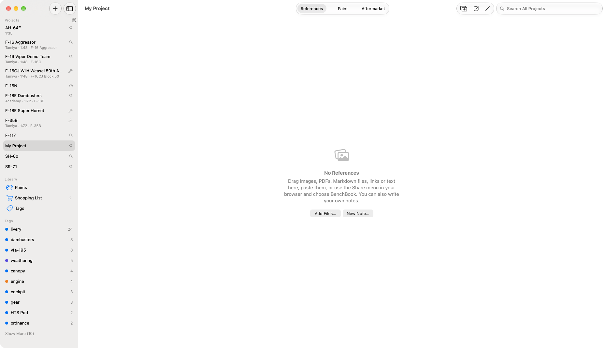

## Reference details

`Views/ReferenceDetailsView.swift`

A dialog for any reference except notes, in sections, top to bottom:

- **Reference Details**: Title (its placeholder is the fallback title), Tags
  ("Separate tags with commas") and Note ("Optional", 3 to 8 lines).
- **Text** (snippets): the captured text, selectable.
- **Video** (video links), with a Refresh button in the header ("Fetch the
  video's details and poster again"), or a spinner while fetching: the poster,
  Channel (a link when there's a channel URL), Length, Published (date only),
  and Description, collapsed. Before the first fetch: "Video details haven't
  been fetched yet. BenchBook tries again when it's online."
- **Webpage** (webpages), with Refresh ("Fetch the page's preview image and
  details again"): the preview image (64 pt with rounded corners when it's an
  icon), Site, and the description. Before the first fetch: "The page's
  preview hasn't been fetched yet. BenchBook tries again when it's online." If
  the page offered nothing: "This page doesn't offer a preview."
- **Moments** (videos that have any): each moment as a link that opens the
  video at that time. Moments come only from the timestamp in a saved link.
  There's no way to add or edit them yet.
- **Information**, each row only when there's a value: Type, Added (date and
  time), Source (a link showing the site's host), Original File (a link to the
  web address the file came from, showing the last part of the address), File
  Name (the name the file had when it was added), Size, and Dimensions
  ("1200 × 819").
- Cancel and Save. A save error shows "Couldn't Save Reference".

The Mac also has "Suggest Title and Note" (Apple Intelligence) for images,
which fills the title and note, offers suggested tags as buttons, and can be
undone. The Windows app leaves all of this out.

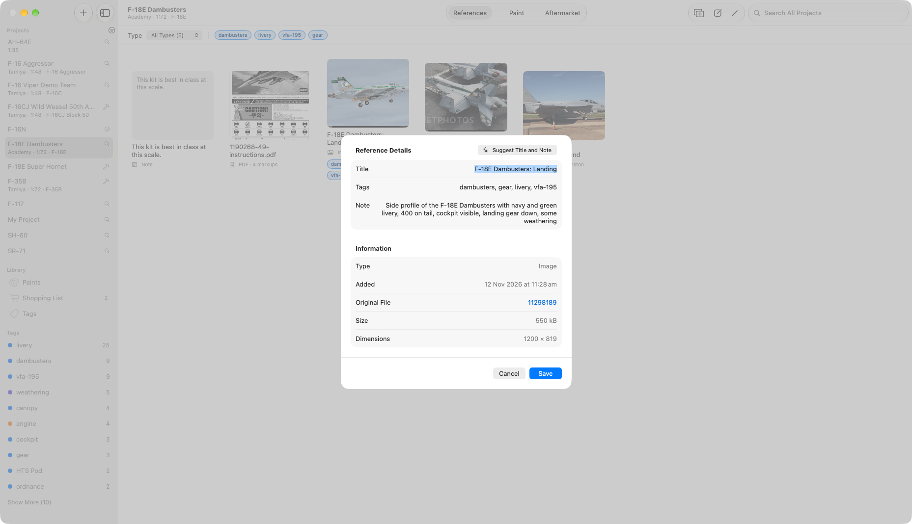

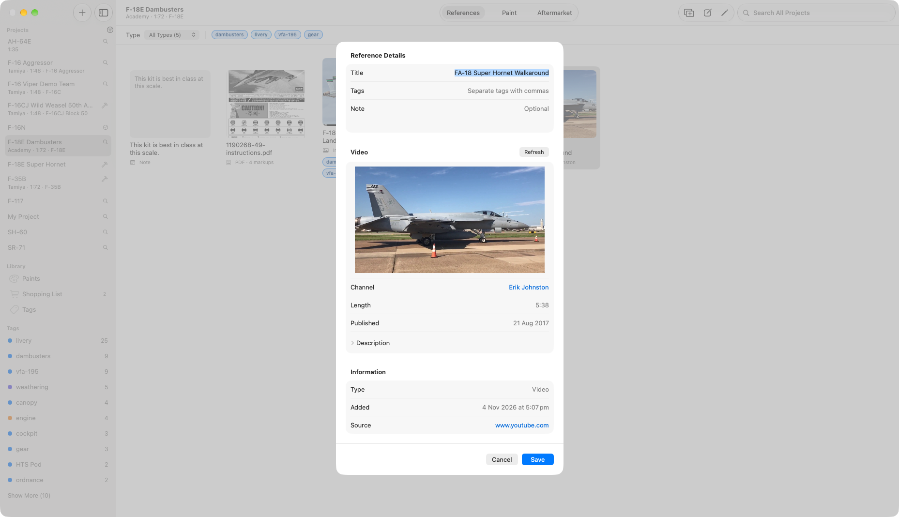

## Note editor

`Views/NoteEditorView.swift`

"New Note" or "Edit Note": "Title (optional)", a large text area ("Write your
note…", focused when the note is new) and "Tags, separated with commas". The
buttons are Cancel and Add Note (Save when editing), and Add Note stays disabled
until there's a title or some text. If the save still fails for that reason,
"Couldn't Save Note" says "Write a title or some text for the note."

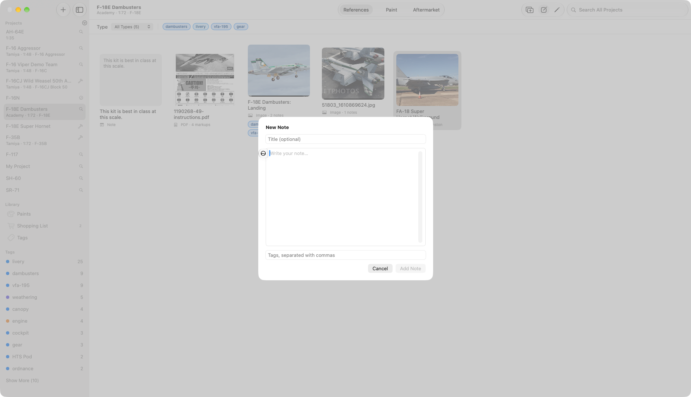

## Project editor

`Views/ProjectEditorView.swift`

"New Project" or "Edit Project": Name ("Required"), Manufacturer ("e.g.
Tamiya"), Subject ("e.g. F-16CJ Block 50"), Scale ("e.g. 1:48"), Kit Number
("Optional"), Markings Scheme ("Optional"), Status (a menu, each status with
its icon), and Notes ("Optional", several lines). The default status for new
projects is set in Settings. Create (or Save) stays disabled until there's a
name: "Enter a name to save the project."

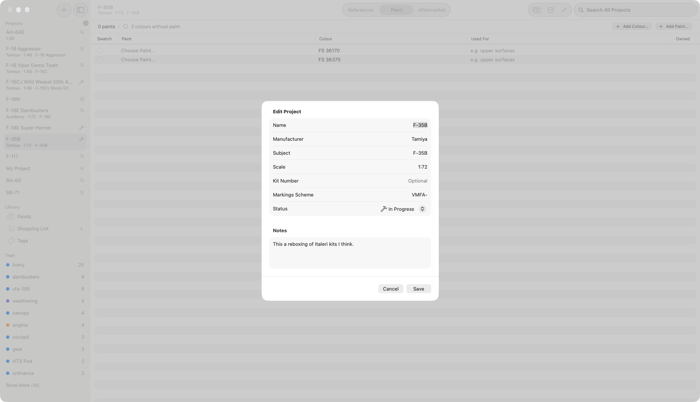

## Edit tags

`Views/Tags/ReferenceTagsSheet.swift`

"Tags for “Main Gear and Bay”" or "Tags for 3 References": the tags on them as
chips with remove buttons, an "Add Tags" field ("Type tags, separated with
commas, then press Return"), and "Add an existing tag" listing the library's
tags. With several references, a tag on only some of them shows as partly on:
"On some of these references. Click to add it to all of them." Existing tags
show in their colours. Each add or remove is saved straight away. Done (also
Escape) adds anything still typed in the field, then closes. Errors show
"Couldn't Change Tags".

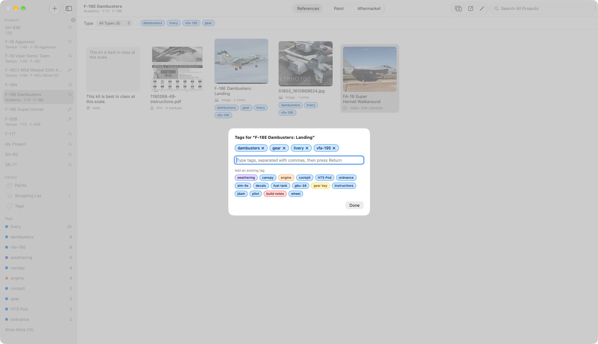

## Paint tab

`Views/Paint/ProjectPaintView.swift`

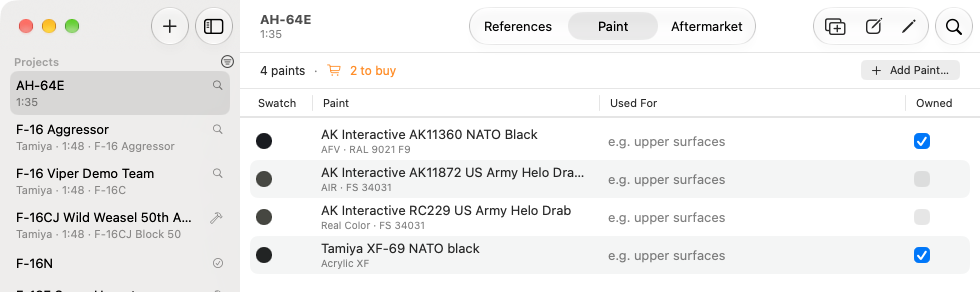

A table, in this order: Swatch, Paint (name, with range and standard
underneath), Colour (the standard from the painting guide), Used For, and Owned
(a tick box: "You own this paint" or "You don't own this paint yet").

The line above it, with Add Colour… and Add Paint… on the right, reads "4 paints
· 2 to buy · 1 colour without paint". "To buy" is orange with a cart icon and
appears only when it's more than zero. So does "without paint", which has a
dashed circle. Counts use the singular for one.

- **Add Colour…** asks for a Colour ("e.g. FS 36270 or RLM 74") and Used For
  ("e.g. upper surfaces"), with Cancel and Add Colour.
- A colour with no paint has an empty, dashed swatch, a "Choose Paint…" button
  in the Paint column ("Choose a paint from your catalogue for this colour"),
  and no Owned tick box.
- **Add Paint…** opens the paint picker.
- Colour ("e.g. FS 36270") and Used For ("e.g. upper surfaces") are edited in
  place.
- Right-click: Choose Paint… or Change Paint…, Remove from Project (or
  "Remove 3 Rows from Project").

Empty: "No Paint. Add the colours from the painting guide, such as FS 36270,
then choose a paint for each. Or add paints from your catalogue directly.",
with Add Colour… and Add Paint… buttons.

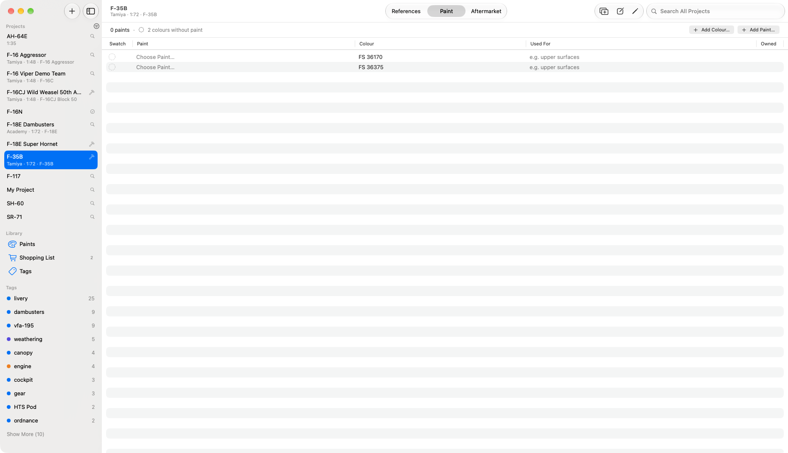

## Paint picker

`Views/Paint/PaintPickerView.swift`

"Add Paint to F-16C" (or "Choose Paint for FS 36270" when choosing for a
colour): a search field ("Search brand, code, name or FS/RLM"), then a list of
catalogue paints, each with a tick box, swatch, name, and range and standard
underneath. Paints you own say "Owned" on the right. Paints already in the
project are left out.

- Adding: tick any number of paints. The button reads "Add Paint", or "Add 3
  Paints", and is disabled until one is ticked.
- Choosing for a colour: only one can be ticked, paints you own are listed
  first, and the button reads "Choose Paint".
- New Paint… (bottom left) opens the paint editor. Cancel closes.

Empty: "No Paints in Catalogue. Create a paint here, or add many at once from
Paints in the sidebar.", or "No Paints to Add. Every paint is already in this
project."

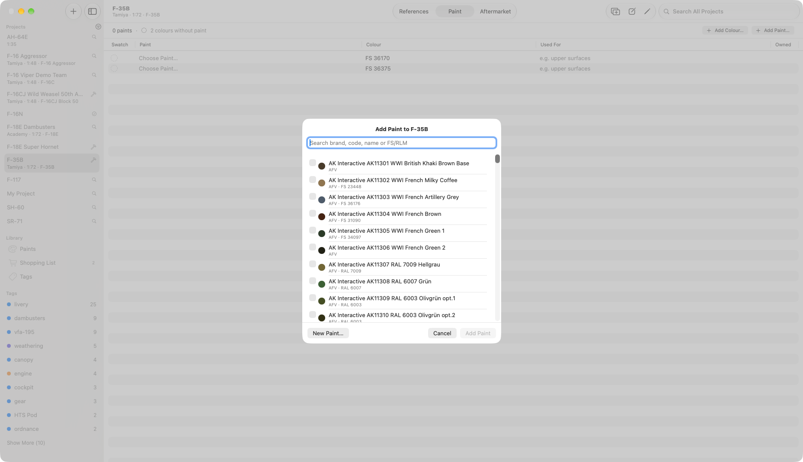

## Paints catalogue

`Views/Paint/PaintCatalogueView.swift`

A table: Swatch, Brand, Range, Code, Name, FS / RLM, Owned, Projects. The text
columns sort, in natural order. Above it: Brand ▸ and Range ▸ menus ("Tamiya (286)"), Owned Only,
and the count ("286 of 1,267 paints · 40 owned"). Toolbar: Import CSV…,
Export CSV…, Add Paint.

- Double-click to edit. Right-click: Edit Paint…, Mark as Owned or Not Owned,
  Delete Paint… (or "Delete 3 Paints…").
- Deleting a paint used in a project is refused: "Paints used in a project
  can't be deleted until they're removed from it."
- Import shows "Imported 120 Paints", with "6 were already in your catalogue
  and were skipped." and up to ten problems ("…and 4 more problems.").
- Export asks first: "All 1,267 paints are saved with their brand, range, code,
  name, FS / RLM and colour, in a CSV file another BenchBook can import. Leave
  ownership and notes out when sharing.", with "Include whether you own each
  paint" and "Include notes", both off.

Empty: "No Paints. Add the paints you use, or import a CSV file with Brand,
Range, Code, Name, FS/RLM, Colour and Owned columns."

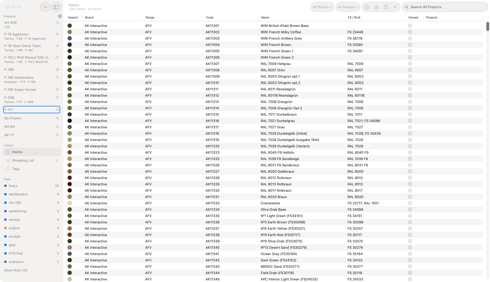

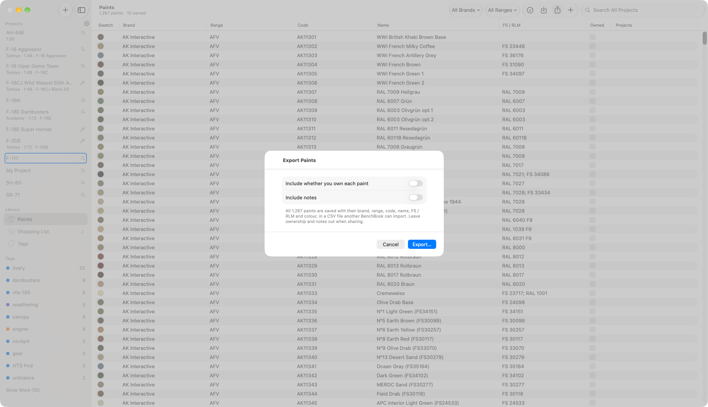

## Paint editor

`Views/Paint/PaintEditorView.swift`

"New Paint" or "Edit Paint": Brand ("Required, e.g. Tamiya"), Range
("e.g. Acrylic XF"), Code ("Required, e.g. XF-54"), Name ("e.g. Dark Sea
Grey"), FS / RLM ("e.g. FS 36270 or RLM 76"), Show a Swatch with a "Swatch Colour"
picker, "I Own This Paint", and Notes ("Optional, e.g. thin 1:1 with X-20A").
Under the swatch: "The swatch only helps you recognise the paint on screen; it
isn't an accurate colour match."

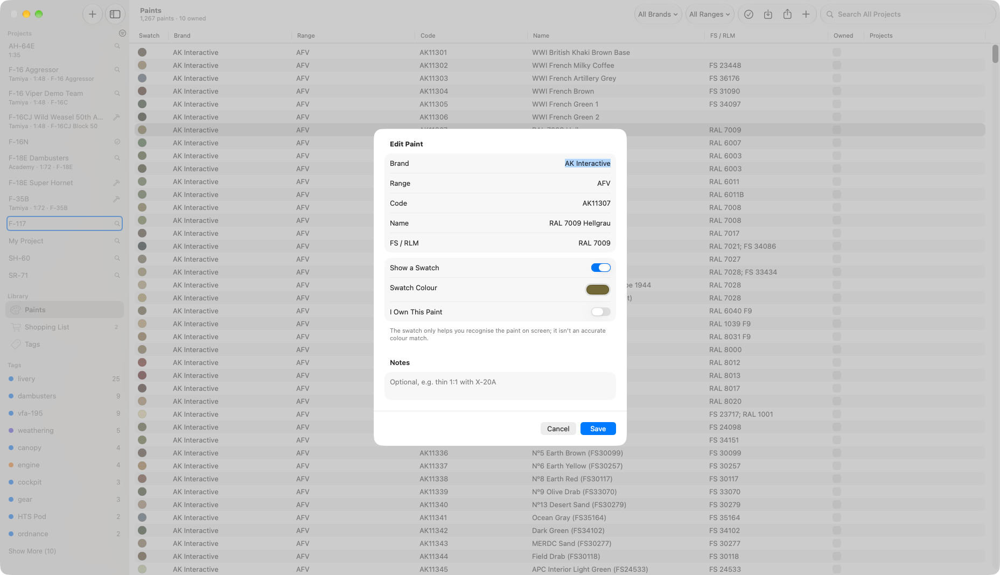

## Shopping list

`Views/Paint/ShoppingListView.swift`

The header counts what's left, such as "2 paints for 1 project · 4 colours
without paint". Grouped by brand. Each paint shows its swatch, code and name, range and
standard, and the projects that need it, with an Owned tick box that takes it
off the list ("Mark as owned and take it off the list"). Right-click: Mark as
Owned, Show in Paints. Then "No Paint Chosen": each colour without a paint,
with an empty swatch, its standard, and the project that needs it (with the
colour's "used for" text in brackets when it has one). These rows have no button, only
the tooltip "Choose a paint for this colour on the project's Paint tab". The
toolbar has Export Shopping List… ("Save the shopping list as a text file").

Empty: "Nothing to Buy. Paints you don't own that a project needs appear here,
with colours that have no paint chosen yet. Completed projects aren't
included."

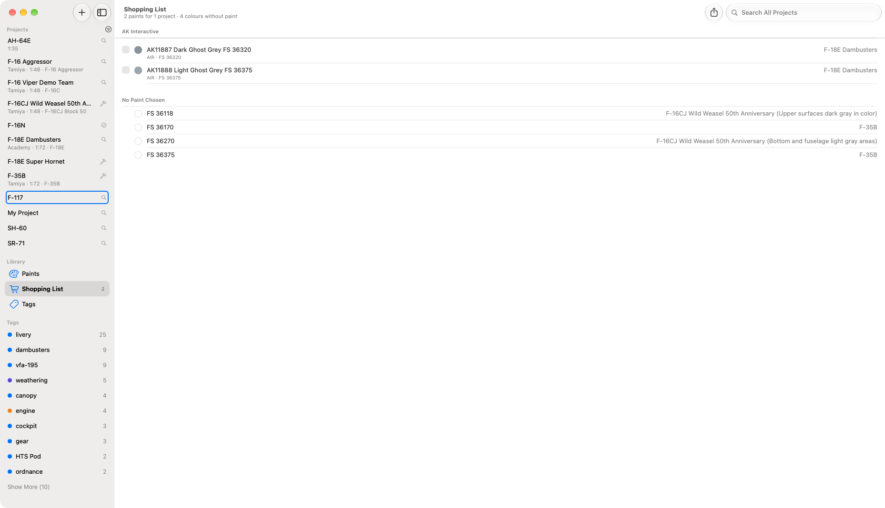

## Aftermarket tab

`Views/Aftermarket/ProjectAftermarketView.swift`

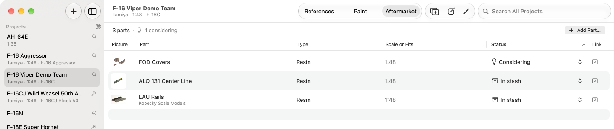

A table: Picture, Part (name, with manufacturer and number underneath), Type,
Scale or Fits, Status (a menu in the row), and Link (opens the product page).
The header line: "3 parts · 1 considering". Add Part… is on the right.

Right-click: Edit…, Open Product Page, Delete Part…. Deleting: "Their details
and pictures are removed from this project."

Empty: "No Aftermarket Parts. Keep track of decals, resin, photo-etch and other
parts you're using or considering for this build."

## Aftermarket editor

`Views/Aftermarket/AftermarketEditorView.swift`

"New Part" or "Edit Part": Name ("e.g. 50th Anniversary 2015"), Manufacturer
("e.g. Galaxy Models"), Product Number ("Optional"), Type (a menu), Status (a
menu, each status with its icon), Scale or Fits ("e.g. 1:48, Tamiya F-16C",
starting with the project's scale), Product Page ("https://…"), and Notes
("Optional").

**Picture**: drop an image, Choose Image…, "Use Image from Product Page"
(disabled until there's a product page: "Enter the product page first"), and
Remove Image. A product page that isn't a web address: "Enter a web address,
such as hannants.co.uk/product/…".

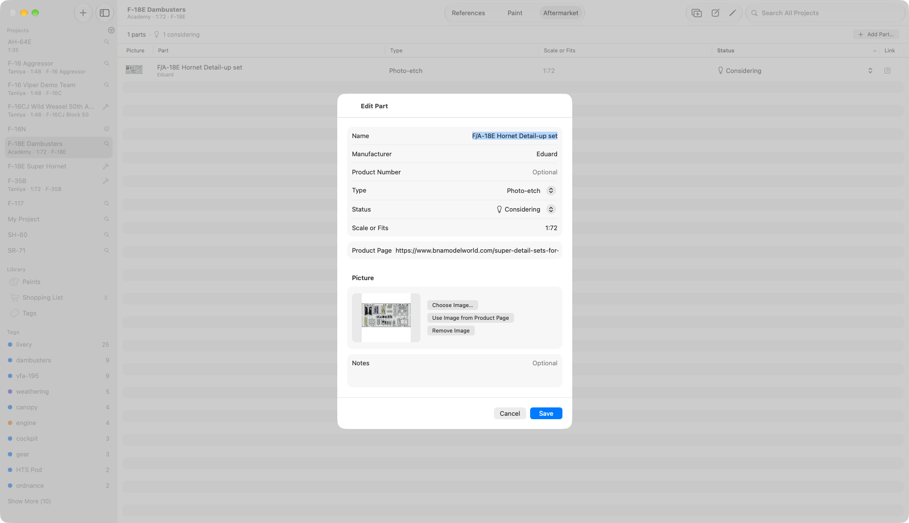

## Tags

`Views/Tags/TagManagerView.swift`, `Views/Tags/TagNameSheet.swift`

A table: Colour, Name, References, Projects. "12 tags" in the header.
Toolbar: New Tag, Remove Unused Tags (disabled with "Every tag is in use").

- Right-click: Show References, Rename…, Colour ▸, Merge 3 Tags…, Delete Tag….
- Merging asks which to keep ("Keep “cockpit”"), with "References with any of
  these tags will have the one you keep. The others are deleted."
- Renaming to an existing name asks "Merge the two tags? References tagged with
  either will have “cockpit”."
- Deleting: "They'll be removed from 14 references. The references themselves
  aren't deleted."

Clicking a tag in the sidebar shows every reference with it, grouped by
project, in the same layout as search results. If none: "Nothing has this tag
yet. Drag references onto it in the sidebar."

Empty: "No Tags. Tags you add to references appear here, where you can rename,
colour, merge and delete them."

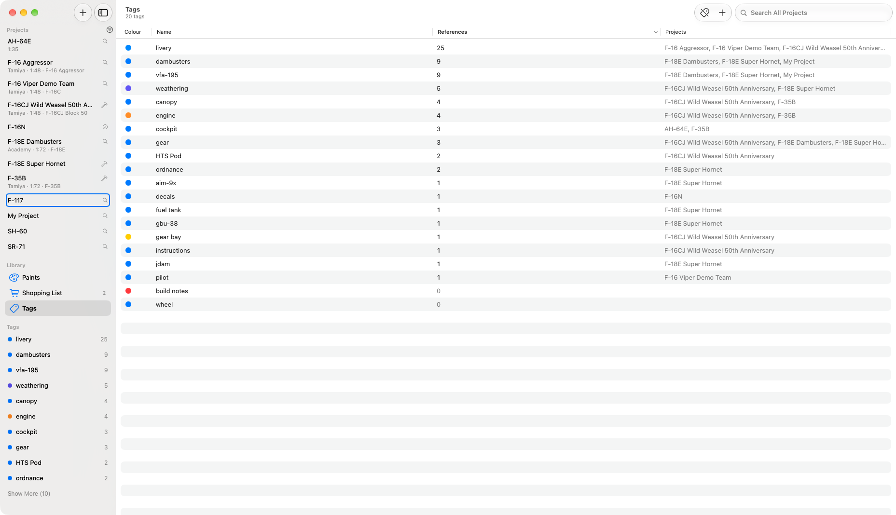

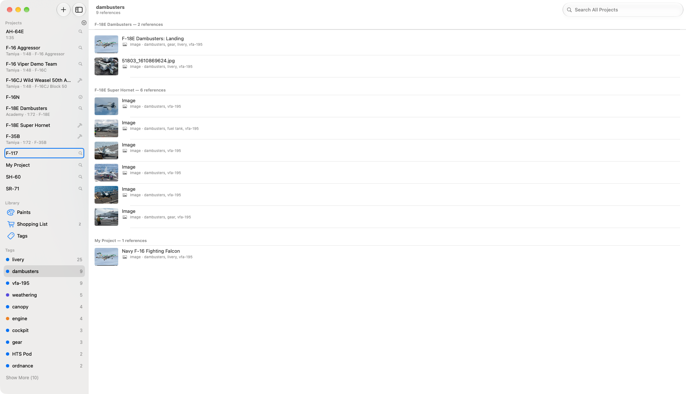

Each group is headed "Project — 2 references" (see Counts at the top).

## Search

`Views/Search/SearchResultsView.swift`

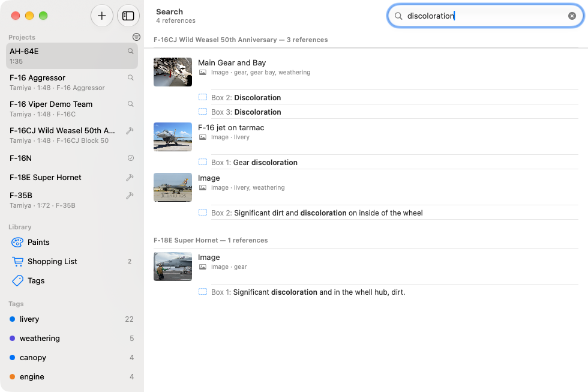

The search field replaces the project with results: "Search · 4 references".
Sections for Projects, Paints and Aftermarket, then references grouped by
project ("F-16CJ Wild Weasel 50th Anniversary — 3 references"). Each reference
shows its thumbnail, title, kind and tags, then a line for each part that
matched ("Box 2: **Discoloration**"). Clicking a box, markup or moment line
opens the image, PDF or video at that spot.

Right-click: Open, Show in Project, Edit Details…, Export Marked-Up Copy…
(PDFs). Paints: Edit Paint…, Show in Paints. Parts: Edit Part…, Show in Project.

## Image viewer

`Views/ImageViewer/ImageViewerWindow.swift`, `ImageCanvas.swift`, `ImageNotesPanel.swift`, `ImageInfoPanel.swift`

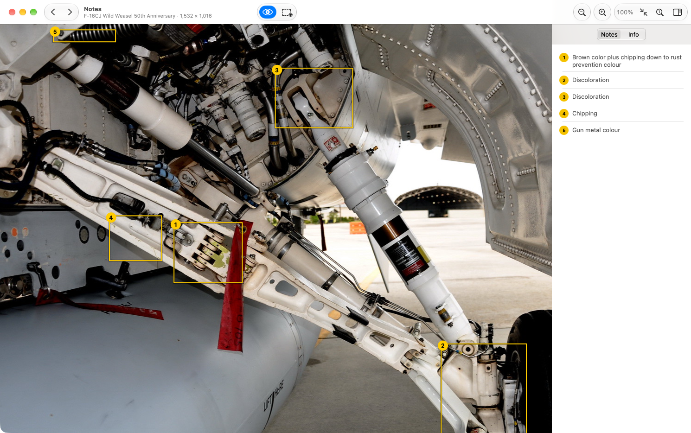

Its own window. The title is the reference's title, with a subtitle like
"F-16CJ · 4,032 × 3,024".

- **Toolbar**: Previous and Next Image (in this project), Show/Hide Boxes,
  Draw Box, zoom out, the zoom percentage, zoom in, Zoom to Fit, Actual Size,
  and Notes and Info.
- **Canvas**: the original image. Scroll or pinch to zoom, drag to pan. Boxes
  are numbered outlines. With Draw Box on, drag to make a box. Select a box to
  move it or drag a corner to resize it.
- **Side panel**, with Notes and Info tabs:
  - Notes: a numbered list, each with a text field ("Describe this feature")
    and Delete Note…. Selecting one selects its box. Empty: "No Notes. Choose
    Draw Box, then drag across a feature of the aircraft to mark it and add a
    note."
  - Info: Image (Format, Dimensions, Megapixels, Colour, Bit Depth, Resolution,
    Transparency), Camera (Camera, Lens, Taken, from EXIF), Source (Added, File
    Name, Size, Page) and Tags.
- A very large image may be shown smaller: "Shown at 8,000 × 6,000 because the
  original is larger than the display can handle. The original is unchanged."
- Deleting a note: "Delete Note? The box and its note will be removed. The
  image isn't changed."

## Compare

`Views/ImageViewer/ImageComparisonWindow.swift`

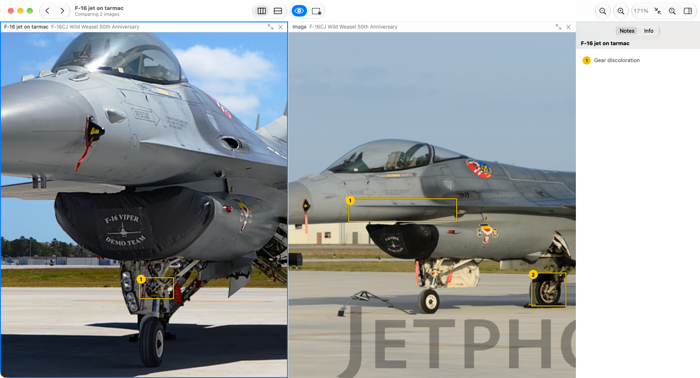

"Comparing 3 images". Each image zooms and pans on its own and shows its boxes.
The toolbar has Side by Side or Grid, zoom for the selected image,
Show/Hide Boxes for all of them, Draw Box on the selected one, and Notes and
Info. On each image: Previous and Next (replaces it with another image from the
project), Show only this image (or double-click it), and Remove from
Comparison. Drag more images in from the grid, up to four: "Drop images here to
compare them too."

## PDF viewer

`Views/PDFViewer/PDFViewerWindow.swift`, `PDFCanvas.swift`, `PDFMarkupsPanel.swift`

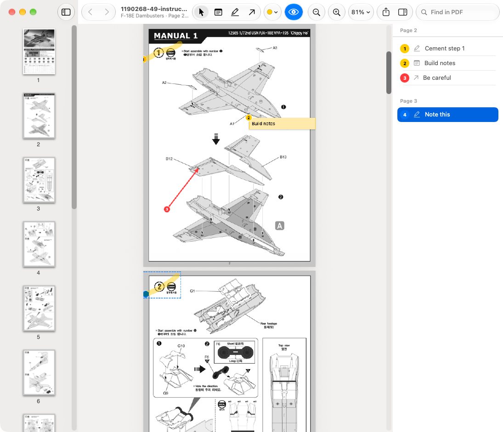

Its own window. Subtitle: "F-16CJ · Page 3 of 12 · 2 of 7 found".

- **Toolbar**: Previous and Next PDF, the tool (Select, Note, Highlight,
  Arrow), Colour, Show/Hide Markups, zoom (with Zoom to Fit and Actual Size
  in its menu), Find, Export Marked-Up Copy…, and Markups.
- **Thumbnails** of the pages on the left.
- **Pages** in a continuous scroll. Note: click to place, then type. Highlight:
  drag along the text; hold Shift for a straight line. Arrow: drag from the
  tail to the tip. Esc goes back to Select. In Select, drag a markup to move it,
  and right-click it for Edit Text, Colour ▸ and Delete Highlight….
- **Markups panel** on the right, grouped by page ("Page 3"), each numbered
  with its kind, colour and a text field ("Write a note", "Describe this
  highlight", "What does it point to?"). Empty: "No Markups. Choose Note,
  Highlight or Arrow in the toolbar, then click or drag on a page."
- **Find**: "2 of 7 found" or "Not found", with Previous and Next Match.
- A password-protected PDF: "This PDF is protected with a password, so
  BenchBook can't show it. Use Open in Default App instead."
- Exporting saves "Title (Marked Up).pdf".

*The screenshot shows empty "Describe this highlight" placeholders. A retake
with text in them would be better.*

## Settings

`Views/SettingsView.swift`

On the Mac, a window with General, Library and Backup tabs. On Windows, a
Settings page.

**General**

- Links: "Fetch webpage previews and video details automatically", explained as
  "After you save a webpage or a YouTube or Vimeo link, BenchBook reads the page
  for its preview image, title and description, or the video's poster, channel
  and length. This is the only time BenchBook goes online on its own. When it's
  off, use Refresh on a link to fetch its details."
- Image Viewer: Open images at Fit to Window or Actual Size; Show note boxes
  when an image opens.
- Projects: Status for new projects (a menu, each status with its icon).
- The Mac also has an Apple Intelligence section ("Suggest titles and notes for
  new images"), between Links and Image Viewer. Windows leaves it out.

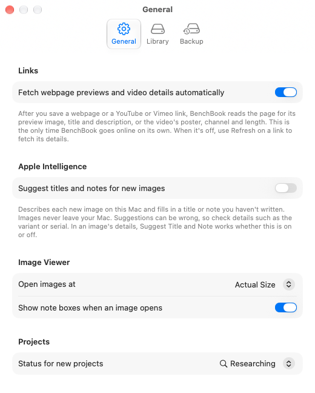

**Library**

- Location: the library folder's full path (blurred in the screenshot), with
  Show in Finder.
- Space Used, in this order: Saved files, Thumbnails, Posters and previews,
  and Total (in bold).
- Maintenance: "Remove unused files" with Clean Up Now ("Deletes saved files
  and previews that nothing uses any more, such as leftovers from an
  interrupted import. BenchBook also does this at launch."), and "Clear
  thumbnails" with Clear Thumbnails ("Deletes the gallery's thumbnails. Each is
  made again from its file when it's next shown.").

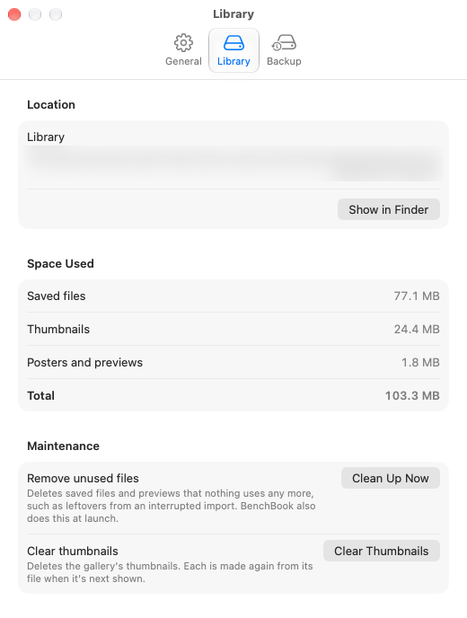

**Backup**

- Back Up Library…: "Saves every project, reference, note, paint and original
  file into one file. Keep it on another drive or in cloud storage." Shows
  "Last backed up 13 November 2026 at 09:41." or "Not backed up yet."
- Restore from Backup…: "Replaces this library with the backup. BenchBook checks
  the backup first, then quits and reopens to finish. The library you have now
  is kept." It asks "Restore the Backup from 12 November 2026 at 18:02?", with
  what it holds, and offers Restore and Reopen.
- While a backup is being checked: a spinner with "Checking the backup…".
- Kept from Before a Restore, only when there are any: each earlier library by
  folder name, with Show in Finder and Move to Trash…, and "Each is the whole
  library as it was before a restore. Keep it until you're sure the restore has
  everything."

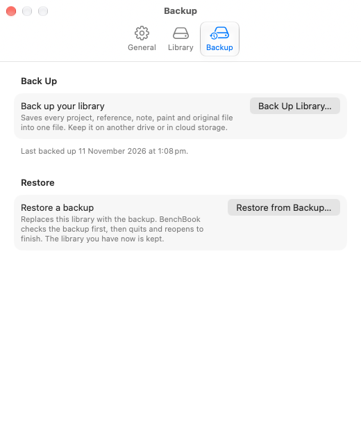

## Share sheet

`BenchBookShare/ShareView.swift`

"Add to BenchBook": the items being shared, a Project menu (starting with the
project last open in BenchBook), Tags ("e.g. wheel well, cockpit"), Note, and
Cancel or Add. Under it: "Items are added when BenchBook is open." With no
projects: "No Projects. Open BenchBook and create a project, then share again."
Items it can't take: "Can't add: name. BenchBook can save images, PDFs,
Markdown files, web links and text."

There's no screenshot: macOS shows this inside the sharing app's window. On
Windows it's the Share target window (see
[windows-app.md](windows-app.md#capture)).

## Library error

`App/BenchBookApp.swift`

If the store can't be opened: "Can't Open Your Library", the error, "BenchBook
didn't change any of your data. Quit and reopen the app to try again." and
Show Library in Finder.
